# JobFinder: Final Project Report

**Course:** Web Technologies (Frontend)

**Group:** IT-2501

**Members:** Almansur Maxym, Adilbek Kairov

**Website:** https://alwoosh0.github.io/WEB_Technologies_Frontend_EndTerm/

**Repository:** https://github.com/Alwoosh0/WEB_Technologies_Frontend_EndTerm

---

## 1. Project objectives

Many students and graduates in Kazakhstan do not know where to look for their first job, and companies cannot easily find motivated candidates. The goal of JobFinder is to bring job seekers and employers together on one simple website.

Our technical goals were:
- build a responsive multi-page website with semantic HTML and external CSS;
- add interactivity with JavaScript and jQuery;
- save user settings and login state in the browser with localStorage;
- load real job data from a public API.

## 2. Website structure

| Page | File | Content |
|------|------|---------|
| Home | `index.html` | Hero with search form, popular categories, featured jobs, how it works |
| Jobs | `jobs.html` | Local vacancies with search and filters, international vacancies from the API, vacancy management (CRUD) |
| Companies | `companies.html` | Company cards, image gallery with lightbox |
| About | `about.html` | Mission, advantages, statistics, FAQ |
| Contact | `contact.html` | Contact form, office information, registration form |
| Sign in | `signin.html` | Sign-in form and profile of the signed-in user |

All pages share the same header with the navigation bar, theme button and sign-in status, and the same footer.

```
index.html, jobs.html, companies.html, about.html, contact.html, signin.html
css/style.css     all styles, CSS variables, light and dark theme, media queries
js/theme.js       applies the saved theme before the page is shown
js/script.js      all JavaScript and jQuery code
images/           SVG images and logos
```

## 3. Implemented features

### 3.1 HTML and CSS
- Semantic HTML5: `header`, `nav`, `main`, `section`, `article`, `address`, `footer`
- One external stylesheet with CSS variables, the Poppins font and a consistent color palette
- Flexbox (header, navigation, filters) and CSS Grid (categories, statistics)
- Mobile-first responsive design with media queries at 768px and 992px and the Bootstrap grid

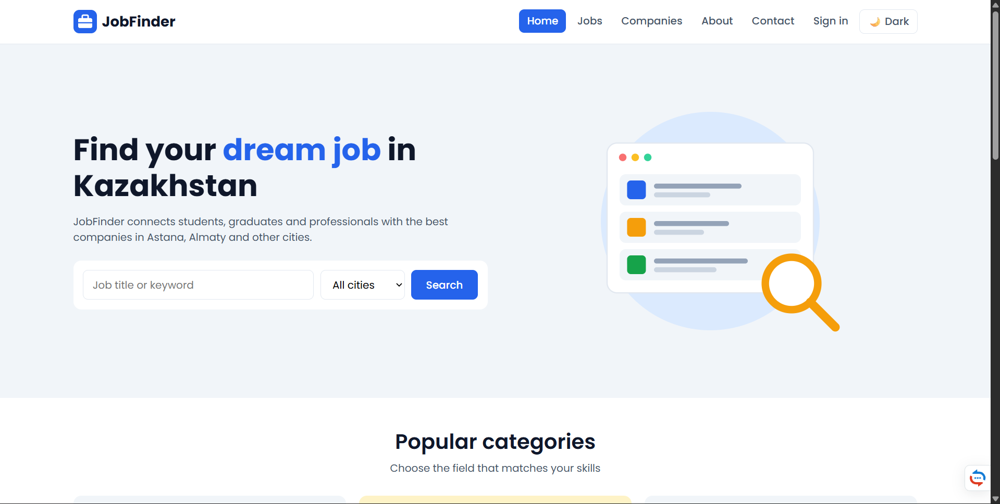

### 3.2 Light/dark theme
The button in the navigation bar switches the theme. The choice is saved in localStorage under the key `theme`. `js/theme.js` is loaded in `<head>`, so the saved theme is applied before the page appears and there is no white flash. The dark theme redefines the CSS variables, and the `data-bs-theme="dark"` attribute also switches Bootstrap components.

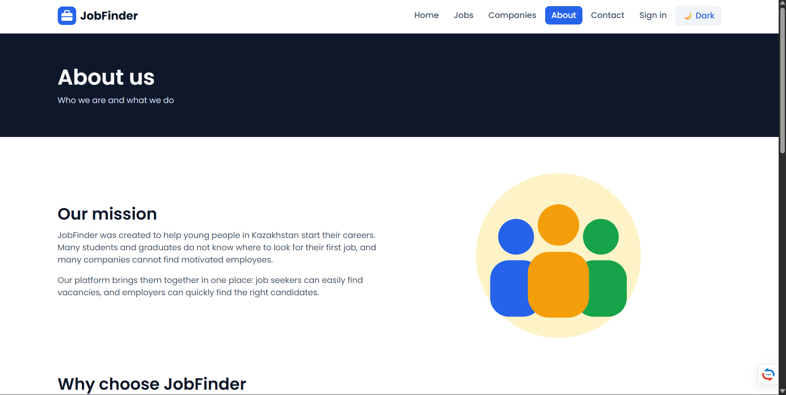
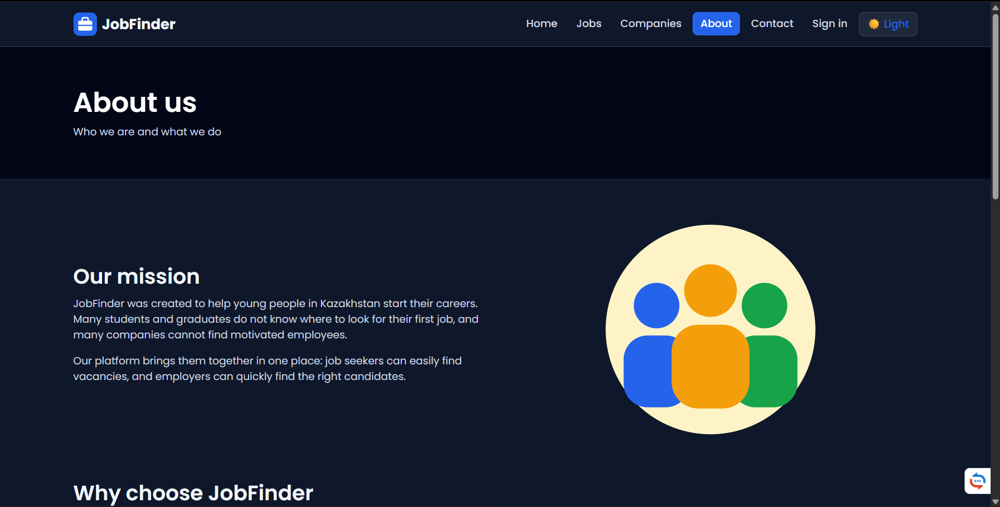

### 3.3 Sign in with localStorage
The sign-in form checks the name (at least 2 characters), the email (regular expression) and the password (at least 8 characters). After a successful sign-in only the name and email are saved in localStorage as JSON. The password is never saved. After a refresh the user stays signed in. Signed-in users see a greeting and a Sign out button in the header, their profile on the Sign in page, and the vacancy management form on the Jobs page. Sign out removes the saved data.


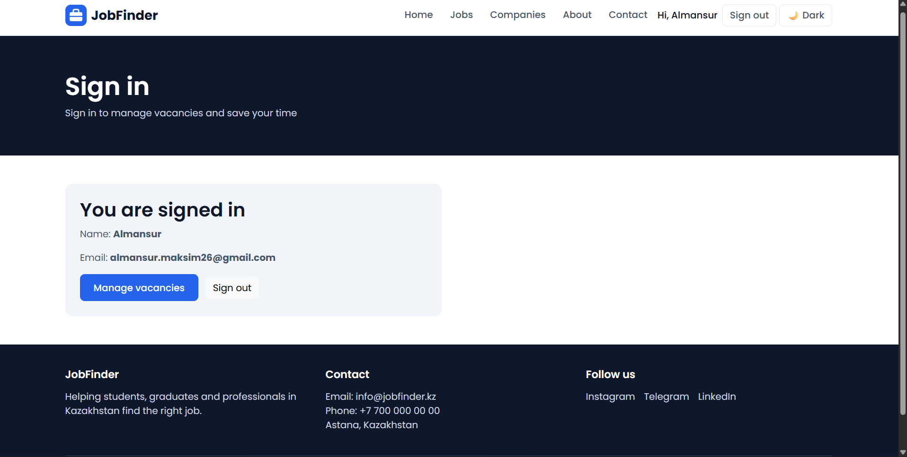

### 3.4 FAQ with jQuery
The About page has 6 questions about the website. Clicking a question opens or closes the answer with `.slideToggle()`, and the icon changes between + and −.

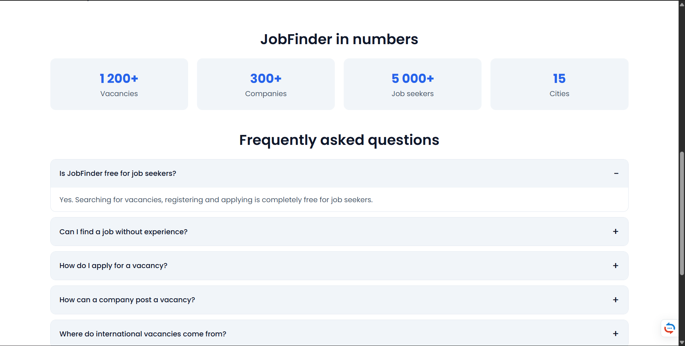

### 3.5 API integration
The Jobs page loads real vacancies from the free Arbeitnow API (`https://www.arbeitnow.com/api/job-board-api`) with `fetch()`. The JSON response is turned into vacancy cards. Users can search by position, company, city or skill, show only remote jobs, move between pages and refresh the data. If the request fails, a clear error message is shown.

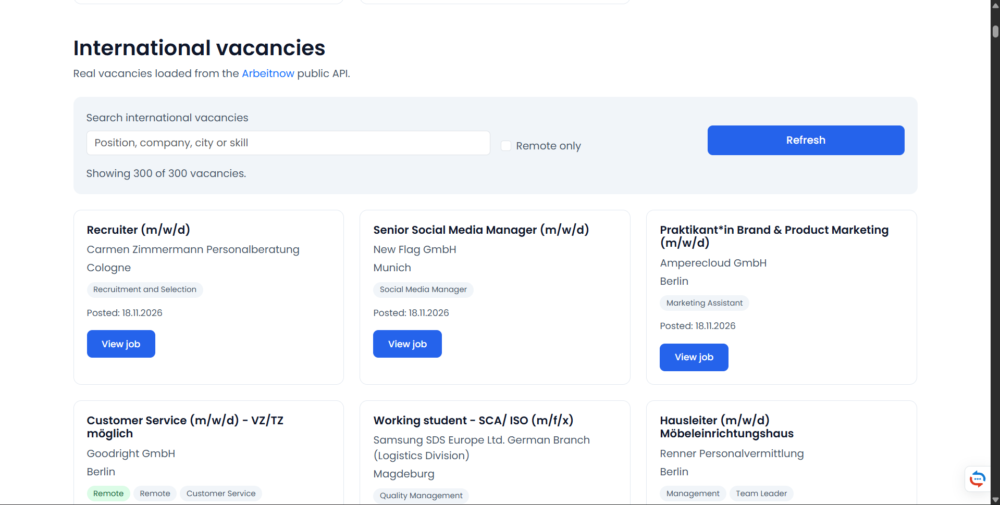
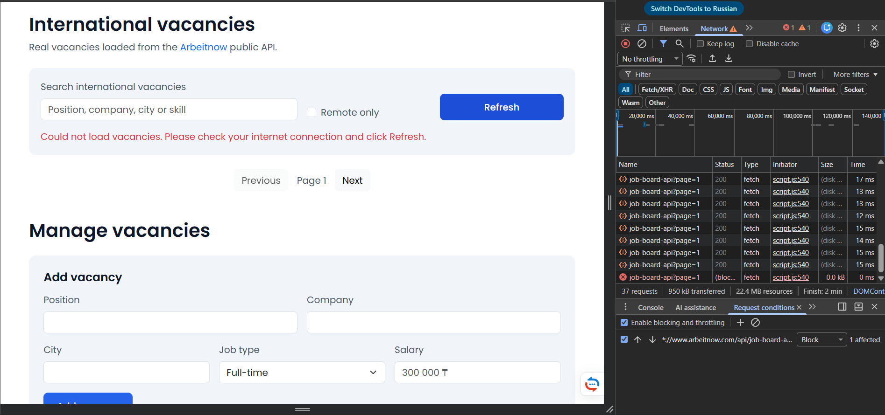

### 3.6 Features from the endterm
- Registration form with required fields, RegEx email check, password strength indicator, password confirmation and real-time feedback
- Live, case-insensitive search and category filters for local vacancies
- Vacancy table with Create, Read, Update and Delete (with confirmation)
- Image gallery with a lightbox, arrows, keyboard control and jQuery fade effects

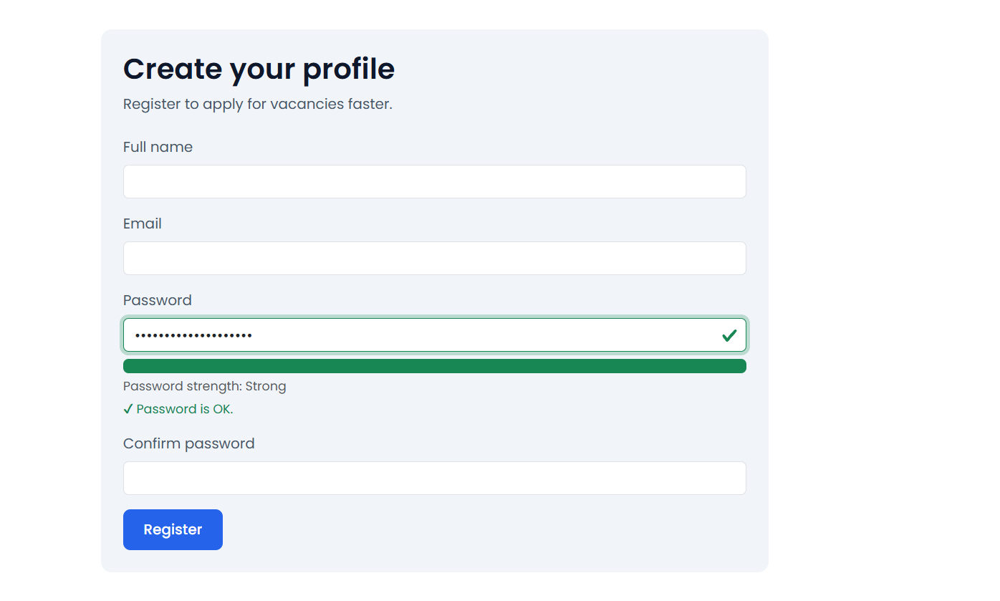
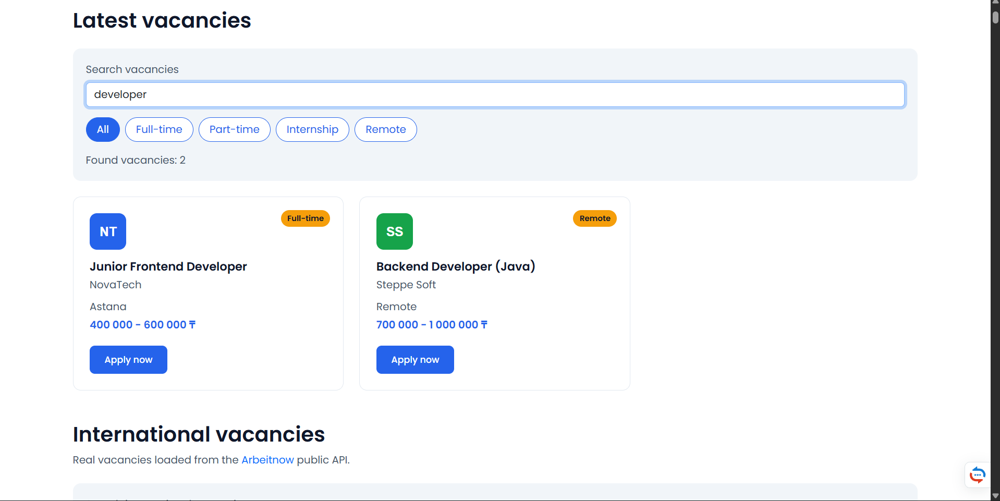
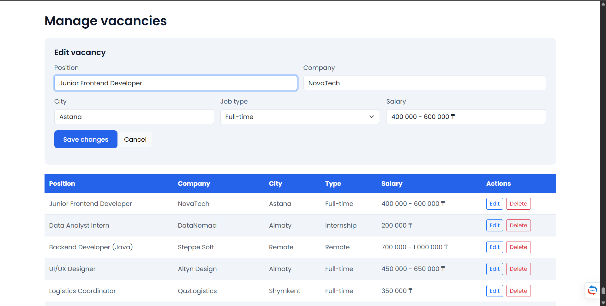
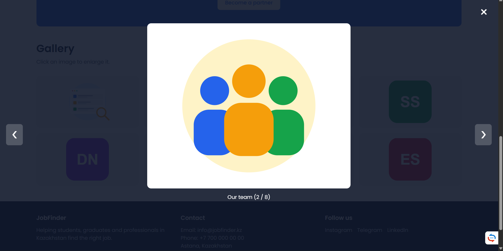

### 3.7 Responsive design

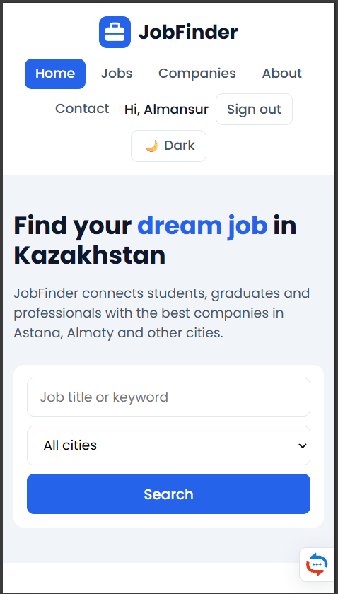

## 4. Development process

1. **Midterm.** We chose the topic, designed the pages and built the layout with HTML, CSS, Flexbox, Grid and Bootstrap.
2. **Endterm.** We added the `js/script.js` file and implemented form validation, search and filters, CRUD and the gallery with jQuery.
3. **Final.** We added the theme toggle and sign-in with localStorage, the FAQ, and chose the Arbeitnow API because it is free, needs no key and returns real job data in JSON.
4. **Testing.** We tested every feature in Chrome on desktop, tablet and mobile widths, checked the console for errors, and tested the API error message by turning off the internet.
5. **Publishing.** All changes were committed to the same GitHub repository and published with GitHub Pages.

## 5. Individual contribution

| Member | Responsibilities |
|--------|------------------|
| Almansur Maxym | API integration, search and filters, vacancy table with CRUD |
| Adilbek Kairov | Theme toggle, sign in with localStorage, FAQ, registration form validation, image gallery |
| Together | Midterm design and pages, responsive testing, report and publishing |

## 6. AI usage

AI assistance: Claude by Anthropic was used for debugging, for explaining some parts of the code and for help with writing some parts of the code. AI usage is also stated in the footer of every page of the website.

## 7. Links

- Website: https://alwoosh0.github.io/WEB_Technologies_Frontend_EndTerm/
- Repository: https://github.com/Alwoosh0/WEB_Technologies_Frontend_EndTerm